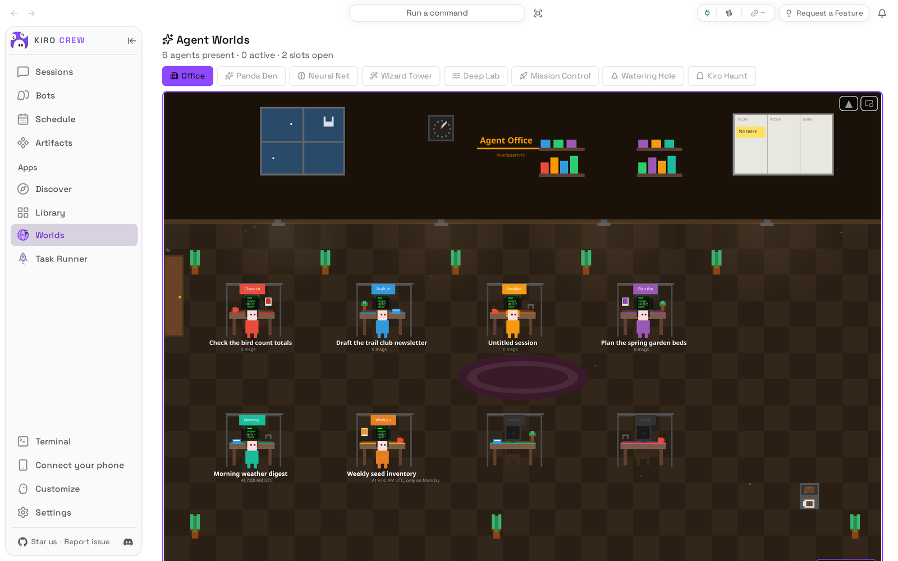
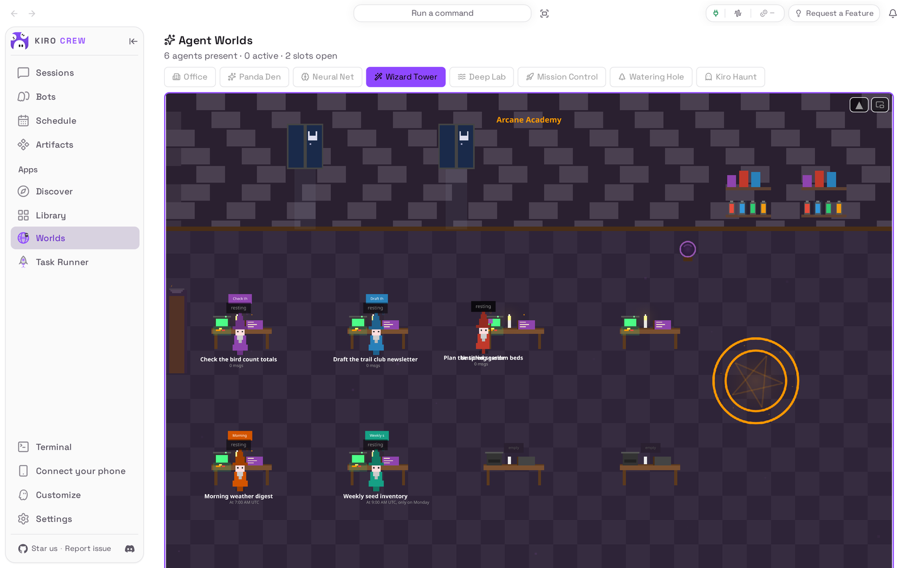
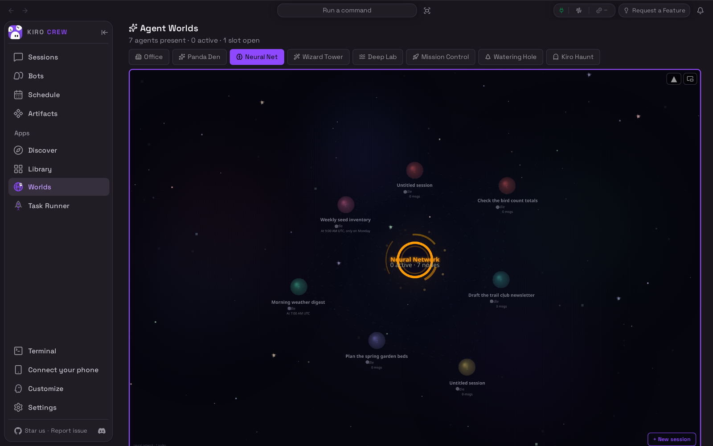
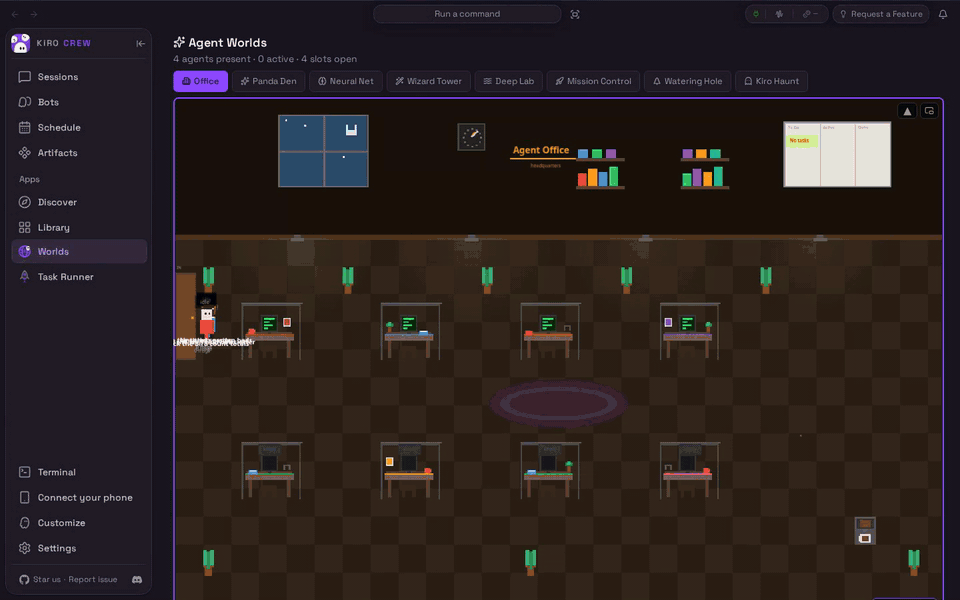

# Agent Worlds

<picture>
  <source media="(prefers-color-scheme: dark)" srcset="docs/media/hero-dark.png">
  
</picture>

**Your running agents as characters in a pixel-art scene, so one glance says how busy your crew is.**

Agent Worlds is an app for [Kiro Crew](https://github.com/kirodotdev/KiroCrew),
the open-source personal AI agent.

## What it is

Agent Worlds adds a **Worlds** page to the sidebar. Each of your chat sessions,
your enabled scheduled jobs and your running subagents appears as a character in
an animated scene: an office, a panda den, a wizard tower, an underwater lab and
more. A character starts working when its agent does and goes idle when it
finishes. Click a session's character to read its latest messages, reply to it,
or approve the tool it is waiting on, without leaving the page.

**Get started:** open **Apps → Discover**, find **Agent Worlds**, choose
**Install**, then **Enable**. See [Install](#install) for the details.

## The problem it solves

When several chats and scheduled jobs run at once, the session list tells you
which ones exist, not which ones are busy, waiting on you, or done. Agent Worlds
turns that into a picture you can keep on a second screen: who is working, who
is idle, who needs your approval. It only shows what your agents are doing and
acts only when you press a button on it; it never starts work on its own.

## Top 3 use cases

### 1. See at a glance who is working

You have a few chats and two scheduled jobs and want to know, without opening
each one, whether anything is running. The header counts the agents present and
active, and every character carries the name of its session or job.



### 2. Pick the world you like

You would rather watch wizards than office workers. Choose a scene from the row
of buttons; Agent Worlds remembers it the next time you open the page.



### 3. Start a new session from the scene

You want a fresh chat but do not want to leave the scene. Choose **+ New
session** in the corner of the scene: a new session starts, and its character
joins the world.



## Watch it



[Watch the walkthrough as a video (MP4)](docs/media/walkthrough.mp4).

<sub>Recorded from a real Kiro Crew (33979525d8) on a throwaway home with
made-up demo data: three titled chat sessions, the untitled one Kiro Crew opens
on its first start, and two scheduled jobs that were not due during the
recording. No AI model was connected and no message was sent, so every
character stays idle; the recording does not show a character working, the
message view, or an approval.</sub>

## Install

**From the Kiro Crew App Store**

1. In Kiro Crew, open **Apps → Discover** in the left sidebar.
2. Search for **Agent Worlds** and choose **Install**.
3. Kiro Crew shows what the app may do before it installs. Agent Worlds asks to
   read your sessions, your scheduled jobs and your subagents, to send messages
   in your sessions, to approve or reject the tools they wait on, and to start
   new sessions. It does each of these only when you press its button.
4. The app installs switched off. Choose **Enable** on its page. **Worlds** then
   shows up under **Apps** in the sidebar and in **Apps → Library**.

Agent Worlds needs Kiro Crew 0.14.0 or later on a Mac, Linux or Windows
computer, in the desktop app or a browser. It needs no account or key, and it
runs no program of its own: it is a page only. If your Kiro Crew already shows
**Worlds** in the sidebar, you have it already, and an update moves it over
with your chosen scene kept.

## First run

The page opens on the **Office** scene with a character for each of your newest
chat sessions, then your enabled scheduled jobs and running subagents, up to
eight in all. With no sessions yet the office is empty; choose **+ New
session** to start one and watch its character arrive.

## How to use it

1. Open **Worlds** in the sidebar.
2. Hover over a character to see what it is doing and its newest message.
3. Click a session's character to open its message view: the last eight
   messages, and a box to reply. While the agent works, what you type steers it
   instead of waiting for it to finish.
4. When a character's message view shows **Waiting on approval**, choose
   **Approve** or **Deny**.
5. Choose **Open chat** in the message view to continue in the full chat.
6. Choose a scene from the row of buttons, or **▲** to hide the header and
   buttons.
7. Choose the pop-out button in the top-right corner of the scene to open the
   scene in its own window, for example on a second screen. The scene choice
   stays in sync between the two.

## Settings & data

- **Where your data lives:** Agent Worlds keeps only your chosen scene and which
  characters a scene has already greeted, in your browser's storage for Kiro
  Crew. It has no data folder of its own. Your sessions, jobs and messages stay
  where Kiro Crew keeps them.
- **What leaves your computer:** nothing goes out from the app itself. A message
  you send from the message view goes to your agent exactly as if you typed it
  in the chat.
- **Turn it off:** **Apps → Library**, open the **⋯** menu on Agent Worlds,
  choose **Disable**. Your sessions are not touched.
- **Remove it:** the same menu, **Uninstall**. Your sessions, jobs and messages
  stay; only the page goes.

## Troubleshooting / FAQ

**The page says "Agent Worlds can't reach your sessions on this version of Kiro Crew."**
Your Kiro Crew is older than 0.14.0. Update Kiro Crew, then open **Worlds**
again.

**Some of my sessions are missing from the scene.**
A scene has room for eight characters: your newest sessions first, then up to
three enabled or running scheduled jobs and three running subagents. Older
sessions are left out until a newer one closes. **+ New session** is greyed out
while the scene is full.

**I pressed Approve and the buttons went away with a note that the approval expired or was already decided.**
The request was answered somewhere else, timed out, or was replaced by a newer
one before your press arrived; if someone else answered it, the note says
whether it was approved or rejected. Nothing more is needed: the agent is no
longer waiting on it.

**My reply came back to the box with a note.**
"Send failed" means Kiro Crew refused the message and nothing was sent; the
note says why. "Delivery not confirmed" means the answer did not come back in
time: look at the conversation before sending it again, so it does not arrive
twice.

**The scene says "Playing in popout window".**
The scene is open in its pop-out window. Choose **Focus popout** to bring that
window forward, or close it to bring the scene back here.

## Development

### Install from a clone

```bash
git clone https://github.com/KiroCrewCaptain/kirocrew-app-agent-worlds
kirocrew app install ./kirocrew-app-agent-worlds
kirocrew app enable agent-worlds
```

The app runs no code of its own, so no trust step is needed.
`kirocrew app disable agent-worlds` turns it off;
`kirocrew app uninstall agent-worlds` removes it.

The page is `ui/src/`, built into the committed bundle `ui/dist/index.mjs`
(Kiro Crew installs a plain clone, with no build step). It reaches Kiro Crew
only through the App SDK: the person's sessions through `useHostSessions`, and
the cron and subagent lists through the app's declared `permissions.api`.
[PORTING.md](PORTING.md) records how it differs from the copy that shipped
inside Kiro Crew.

### Tests

```bash
python -m pip install -r tests/requirements.txt
python -m pytest
cd ui && npm ci && npm run typecheck && npm test && npm run build
git diff --exit-code -- dist
```

### Re-capture the README media

The pictures and the recording come from a real, isolated Kiro Crew gateway
driven by [`capture/`](capture/README.md). After any change to what the app shows:

```bash
python capture/capture.py --kirocrew /path/to/KiroCrew
python capture/check_readme.py
```

Then look at every image and at a few frames of the video before committing
(see [CHECKLIST.md](CHECKLIST.md)).

## License

Apache License 2.0. See [LICENSE](LICENSE) and [NOTICE](NOTICE).
